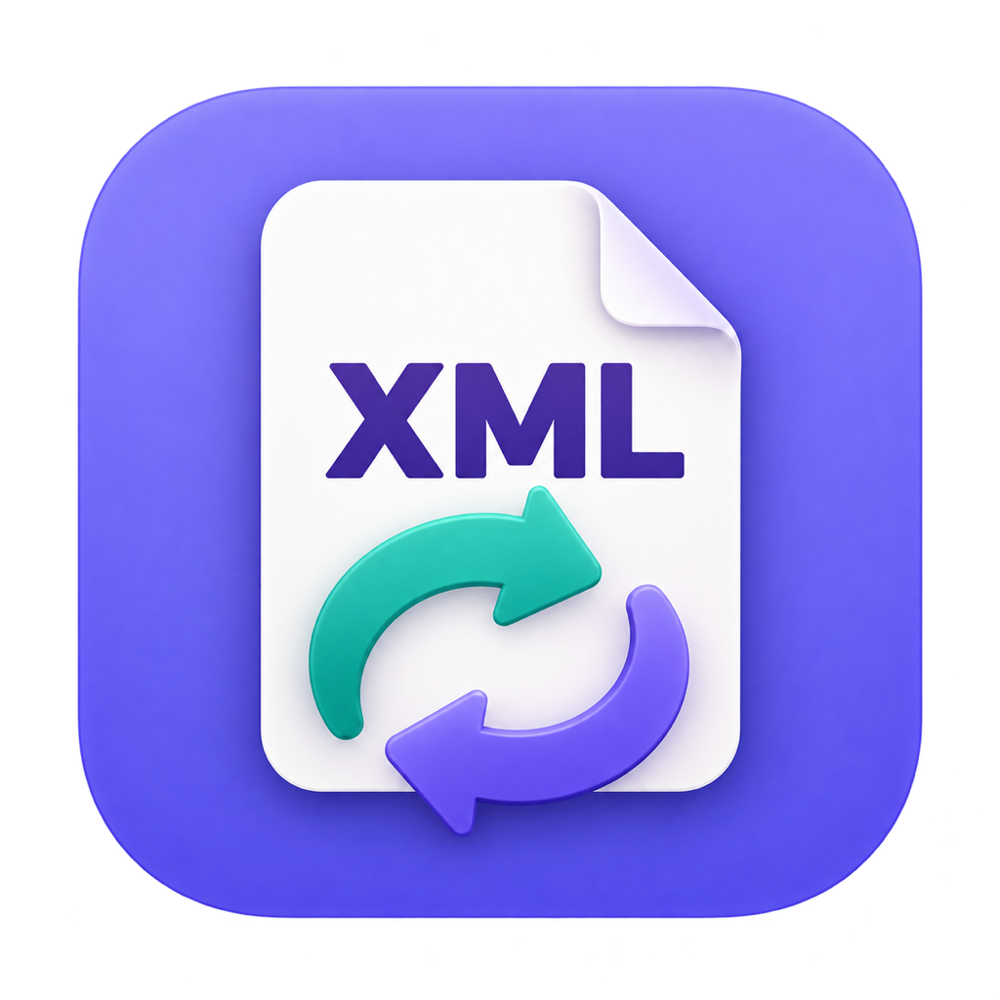
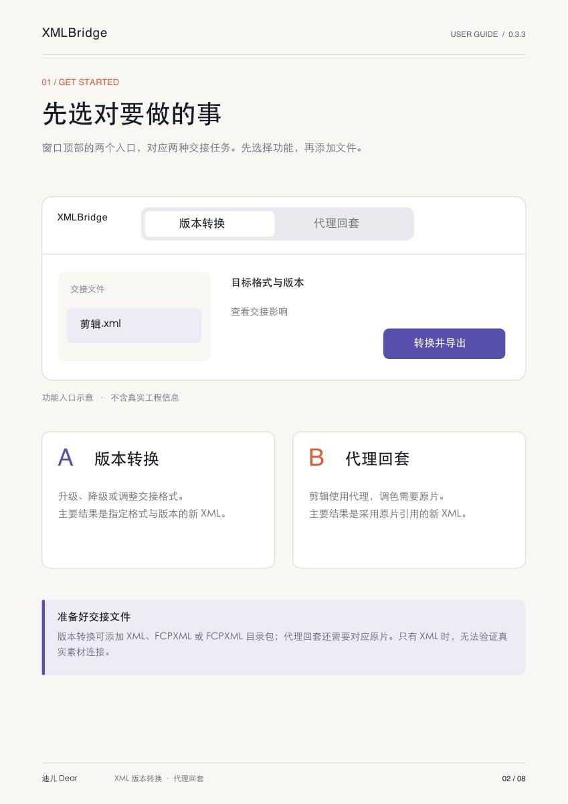

<h1 align="center">XMLBridge · 剪接</h1>

影视 XML 版本转换与代理回套工具

由 <a href="https://github.com/sht2574898282-afk">迪儿 Dear</a> 创作

<a href="https://github.com/sht2574898282-afk/XMLBridge/releases/tag/v0.3.2">下载 0.3.2</a> · <a href="docs/XMLBridge-Manual-0.3.2-zh-CN.pdf">图解使用手册</a> · <a href="LICENSE">许可与署名</a> · <a href="https://github.com/sht2574898282-afk/XMLBridge/issues">反馈问题</a>

用于剪辑交接与调色回套。本机处理 XML，生成新的交接文件，保留原始工程与素材。
现在可以在同一个窗口切换**版本转换**和**代理回套**，并在多个原片候选中人工确认对应文件。

## 当前版本与下载

**0.3.2 预览版**：加入代理回套、放大的功能切换入口、八页图解手册、源码和许可；清理了构建环境路径残留。

| 下载内容 | 说明 |
| --- | --- |
| [Apple 芯片 Mac 完整包](https://github.com/sht2574898282-afk/XMLBridge/releases/download/v0.3.2/XMLBridge-0.3.2-complete-macOS-arm64.zip) | 包含软件、完整对应源码包、手册、README 与许可 |
| [Apple 芯片 Mac 软件包](https://github.com/sht2574898282-afk/XMLBridge/releases/download/v0.3.2/XMLBridge-0.3.2-macOS-arm64.zip) | 仅需安装软件时使用；源码可从同一发布页免费取得 |
| [源码包](https://github.com/sht2574898282-afk/XMLBridge/releases/download/v0.3.2/XMLBridge-0.3.2-source.zip) | 可阅读、可修改的源码，包含构建脚本、测试和第三方声明 |
| [八页 PDF 手册](https://github.com/sht2574898282-afk/XMLBridge/releases/download/v0.3.2/XMLBridge-Manual-0.3.2-zh-CN.pdf) | 版本转换、代理回套、候选选择、状态解释与许可 |
| [校验清单](https://github.com/sht2574898282-afk/XMLBridge/releases/download/v0.3.2/SHA256SUMS.txt) | 本次发布附件的 SHA-256 |

0.3.2 提供 macOS Apple 芯片安装包，构建最低目标为 macOS 13，实际验证环境为当前 Apple 芯片 Mac；没有在 macOS 13 实机上验证。
安装包使用本地临时签名，未经 Developer ID 签名或 Apple 公证；首次打开提示可参阅 [Apple 官方帮助](https://support.apple.com/zh-cn/102445)。
运行安装包无需另装 Python。

Intel Mac 和 Windows x64 的 **0.2.0 历史测试版**继续保留在[旧版下载页](https://github.com/sht2574898282-afk/XMLBridge/releases/tag/v0.2.0)，不代表已更新到 0.3.2，也不包含本次新增整合功能。

## 两项功能

### 版本转换

添加 XML、FCPXML 或 FCPXML 目录包 → 选择项目、目标格式与版本 → 查看影响 → 导出 → 在目标软件核对。

支持版本升降和有限范围的跨格式交接。默认允许同格式有损转换，已知简化与未通过的检查会明确记录；跨格式缺少可靠映射等情况仍会停止。
原生工程文件如 `.prproj`、`.drp` 或 `.fcpbundle`，请先在源软件中导出 XML。

### 代理回套

添加 Premiere 导出的 xmeml 4/5 → 选择原片目录与代理尾缀 → 扫描 → 确认并采用原片 → 生成新的 XML。

- S03 只是文件名匹配规则，**不能用于判断相机品牌**。未采用的素材不会被批量删改尾缀。
- 多个候选会显示各自位置、帧率、时长、时间码和分辨率，可预览或手动指定原片。
- **只有明确采用的对应关系才写入新 XML。** 未采用、未找到或暂不能处理的素材保留原引用。
- 帧率差异和一帧差异仅作提示，不自动转换帧率、补帧或补偿偏移。
- 生成的是可导入的原片回套 XML，同时附带 HTML、JSON 记录。

新 XML 保留已检查的剪辑点和结构。参数一致、结构检查通过，都不能代替画面对齐确认；正式调色前仍需在目标软件对照参考视频。

## 支持范围

| 类型 | 当前范围 |
| --- | --- |
| FCPXML 同格式版本迁移 | 1.8–1.14 的识别、升级和降级 |
| 旧式 Final Cut XML | XMEML 4 / 5 的识别和版本迁移 |
| FCPXML ↔ XMEML | 基础直接媒体剪辑、轨道顺序、空隙、源入出点、普通标记，以及下列已支持的参数 |
| 静态画面参数 | 中心原点的等比缩放、旋转、普通混合模式下的不透明度 |
| 音频 | 已识别的单声道、立体声及音画链接；整体静态音量 -120 至 +12 dB 或静音 |
| 分析与交接 | 项目选择、帧率和时长、素材引用、逐项影响与处理决定、批处理及报告 |

跨格式转换暂不支持变速、冻结帧、转场、标题、字幕、嵌套、复合片段、多机位、次级 storyline 和同轨重叠。位移、改锚点、非等比缩放、动画、复杂效果、色彩及特殊音频路由没有通用无损映射；部分可逐项明确移除，其余会阻断。同格式迁移按目标版本能否表达逐项处理，不会一律移除高级结构。

时间不能精确落在目标格式的帧边界、源范围与时长不一致、媒体信息不足，或声道与音画关联不完整时，跨格式转换也会阻断。XMEML → FCPXML 缺少可靠颜色空间映射时，须明确选择 Rec.709 或停止，并在目标软件核对素材解释。

外部素材保持引用，不会自动汇集成完整媒体包，不下载远程素材、不转码或渲染。离线素材需要在目标软件重新链接。输出为目录包时，请整体保留和交接。

历史样例验证覆盖 DaVinci Resolve 21.1.1 的部分基础交接、静态参数，以及 Final Cut Pro 11.2 的指定 FCPXML 1.9 样例；不代表任意工程或效果均通过。Final Cut Pro 12.4 与 Premiere 的对应真实导入尚未完成。每次正式交接仍需在目标软件核对剪辑点、时长、音画同步和画面声音。

## 许可与作者署名

Copyright © 2026 **迪儿 Dear**。作者主页：<https://github.com/sht2574898282-afk>

采用 [XMLBridge 署名 同许可源码公开 免费分发许可 1.0](LICENSE)：

- 可以免费取得、使用、学习、修改和分享本项目。
- 复制、修改或整合受保护的代码或设计，必须保留“迪儿 Dear”及作者主页，并标明修改。
- 对外分发或提供网络功能的衍生版本，必须免费公开完整对应源码，衍生部分继续适用同一许可。
- 软件及衍生版本不得销售、收费授权、收费订阅或通过强制付费门槛变相出售。
- **允许使用软件完成收费的剪辑、调色工作。** 客户素材、工程、输出 XML、视频等工作成果无需公开。

该许可带有收费限制，属于自定义**源码可用许可**，不属于 OSI 定义的开源许可，也不是 GPL / AGPL 的修改版。
单纯借鉴思想或功能而独立实现的情形，以法律规定为准。本说明是摘要，完整条款以 LICENSE 为准。

衍生项目的署名示例：

> 基于 XMLBridge，由迪儿 Dear 创作。  
> 作者主页：https://github.com/sht2574898282-afk  
> 本版本由〔修改者〕修改，完整对应源码见〔本版本源码地址〕。

第三方组件仍遵循各自原许可；详见 [第三方声明](docs/THIRD_PARTY_NOTICES.md) 和 `docs/licenses`。
本项目自定义许可不改变第三方权利，也不限制按其原许可修改、替换或重新链接相关独立组件。

## 源码与构建

- `xmlbridge`：XML 转换、检查和代理回套核心。
- `scripts/native`：macOS 原生界面。
- `scripts/build_macos.sh`、`scripts/build_ffprobe_macos.sh`：应用和无网络 ffprobe 的构建脚本。
- `scripts/build_windows_portable.py`：既有 Windows 构建入口；本次没有发布新版 Windows 安装包。
- `tests`：回归测试；`requirements-build.lock`：本次 Apple 芯片构建所用依赖版本。
- `scripts/build_manual.py`：手册排版源，需要 ReportLab 和有嵌入授权的中文 TrueType 字体。

需要 Python 3.12 或更新版本。开发入口为 `python -m xmlbridge`；运行源码需安装 `pyproject.toml` 声明的依赖。
原生界面需要 Xcode Command Line Tools。手册字体不随源码分发，用 `XMLBRIDGE_MANUAL_FONT_DIR` 指定含 HeitiSC-Light.ttf 和 HeitiSC-Medium.ttf 的字体目录。

0.3.2 更新原生界面、手册、许可及构建脱敏，转换引擎逻辑沿用 0.3.0；当前 Python 包版本保留引擎版本，软件发行版本由 RELEASE_VERSION 记录为 0.3.2。

## 验证与隐私

0.3.2 已完成：原生界面编译及帮助菜单检查、14 项本次相关回归测试、打包自检、实际版本转换、代理扫描与选择后生成 XML、非索尼 S03 素材保持原引用、30 个二进制架构与系统目标检查，以及解压后的签名检查。
这些检查不等于任意客户工程或目标软件都能无损交接。

软件与发布附件经过递归隐私扫描，包括内置压缩模块、PDF 文本和属性；已清理本机构建目录标识。
源码中的隐私负例测试包含故意构造的虚构路径，与用户实际目录无关。

**使用软件生成的 XML 仍包含素材引用，HTML / JSON 报告会记录完整路径。** 对外提交反馈前，请检查项目名称、素材路径、时间码等信息，不要直接上传客户资料。

通过 [Issues](https://github.com/sht2574898282-afk/XMLBridge/issues) 提供版本、系统、输入和目标格式、复现步骤，以及去除敏感信息的报告或最小样例。
