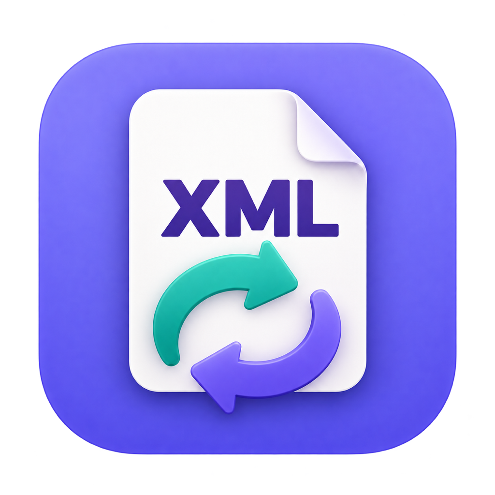
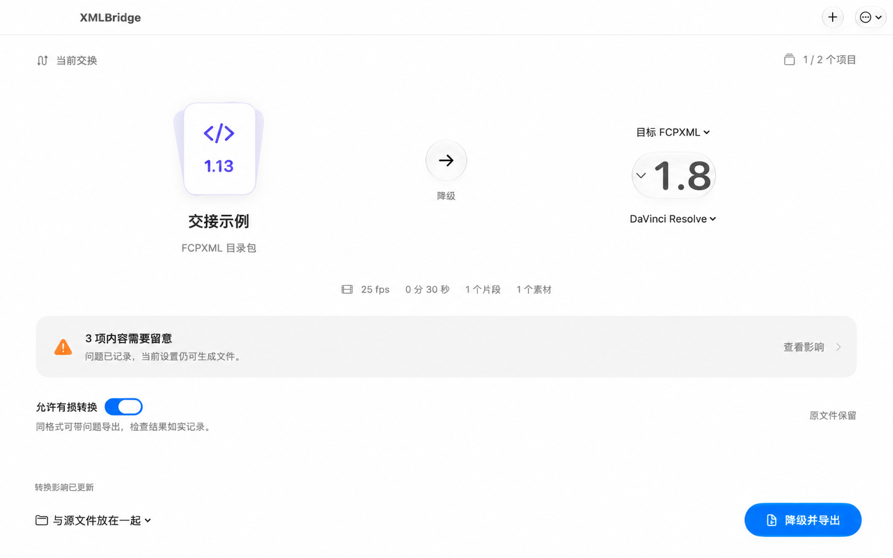

<h1 align="center">剪接 · XMLBridge</h1>

影视 XML 版本迁移与工程交接工具

<a href="https://github.com/sht2574898282-afk/XMLBridge/releases/tag/v0.2.0">下载安装包</a> · <a href="https://github.com/sht2574898282-afk/XMLBridge/releases/download/v0.2.0/XMLBridge-Manual-0.2.0-zh-CN.pdf">中文说明书</a> · <a href="https://github.com/sht2574898282-afk/XMLBridge/issues">反馈问题</a>

帮助剪辑师和工作室分析剪辑 XML、迁移格式版本，并在已支持的范围内交接可编辑时间线。文件在本机处理，导出新文件和报告，保留原文件。

## 下载与安装

当前版本：**0.2.0 预览版**。进入 [下载页](https://github.com/sht2574898282-afk/XMLBridge/releases/tag/v0.2.0)，按设备选择：

| 设备 | 安装包 | 系统要求 |
| --- | --- | --- |
| Apple Silicon（M 系列） | `XMLBridge-0.2.0-macOS-arm64.zip` | macOS 26 及以上 |
| Intel Mac | `XMLBridge-0.2.0-macOS-x86_64.zip` | macOS 13 及以上 |
| Windows x64 | `XMLBridge-0.2.0-Windows-x64-preview2.zip` | Windows 10（1809 及以上）或 Windows 11 |

Mac：解压后将 `XMLBridge.app` 拖到“应用程序”文件夹，再打开。当前安装包使用本地临时签名，尚未经过 Apple 公证。首次打开的系统提示及处理方式见 [Apple 官方帮助](https://support.apple.com/zh-cn/102445)。

Windows：完整解压 ZIP，进入文件夹运行 `XMLBridge.exe`；请保留同目录的运行文件，不要单独移动 EXE。运行前无需安装 Python。

下载页同时提供中文 PDF 说明书和 `SHA256SUMS.txt` 校验清单。**Windows 版本已通过真机启动验证，但本工具尚未经过广泛测试。**

## 使用方法

添加文件 → 选择项目、目标软件及格式版本 → 查看影响 → 导出 → 在目标剪辑软件中核对。

支持 `.xml`、`.fcpxml` 和 `.fcpxmld` 目录包，可拖入或通过选择窗口添加，支持批量与项目选择。原生工程如 `.fcpbundle`、`.prproj`、`.drp` 请先在源软件中导出 XML。

默认开启“允许有损转换”：已知简化会执行并记录；同格式未知内容会保留并报告，检查未通过时仍可生成文件，结果会标为有问题。关闭开关可使用严格模式。损坏 XML、无效版本或项目、分析后改变的源文件，以及跨格式缺少可靠映射的内容仍会停止。

每个文件独立生成转换结果与 HTML / JSON 报告；批次部分失败不会影响其他文件。**文件生成、结构检查、时间线核对、目标软件导入是不同状态**，工具不会将本次输出自动标为已通过剪辑软件验证。

## 支持范围

| 类型 | 当前范围 |
| --- | --- |
| FCPXML 同格式版本迁移 | 1.8–1.14 的识别、升级和降级 |
| 旧式 Final Cut XML | XMEML 4 / 5 的识别和版本迁移 |
| FCPXML ↔ XMEML | 基础直接媒体剪辑、轨道顺序、空隙、源入出点、普通标记，以及下列已支持的参数 |
| 静态画面参数 | 中心原点的等比缩放、旋转、普通混合模式下的不透明度 |
| 音频 | 已识别的单声道、立体声及音画链接；整体静态音量 -120 至 +12 dB 或静音 |
| 分析与交接 | 项目选择、帧率和时长、素材引用、逐项影响与处理决定、批处理及报告 |

跨格式转换暂不支持变速、冻结帧、转场、标题、字幕、嵌套、复合片段、多机位、次级 storyline 和同轨重叠。位移、改锚点、非等比缩放、动画、复杂效果、色彩及特殊音频路由没有通用无损映射；部分可逐项明确移除，其余会阻断。同格式迁移按目标版本能否表达逐项处理，不会一律移除高级结构。

时间不能精确落在目标格式的帧边界、源范围与时长不一致、媒体信息不足，或声道与音画关联不完整时，跨格式转换也会阻断。XMEML → FCPXML 缺少可靠颜色空间映射时，须明确选择 Rec.709 或停止，并在目标软件核对素材解释。

外部素材保持引用，不会自动汇集成完整媒体包，不下载远程素材、不转码或渲染。离线素材需要在目标软件重新链接。输出为目录包时，请整体保留和交接。

历史样例验证覆盖 DaVinci Resolve 21.1.1 的部分基础交接、静态参数，以及 Final Cut Pro 11.2 的指定 FCPXML 1.9 样例；不代表任意工程或效果均通过。Final Cut Pro 12.4 与 Premiere 的对应真实导入尚未完成。每次正式交接仍需在目标软件核对剪辑点、时长、音画同步和画面声音。

## 使用提示与责任说明

使用前，请务必备份原始工程、XML 文件及相关素材，建议先在副本上测试，并自行核对转换结果后再用于正式项目。请确保对所处理的数据拥有合法使用权限，并遵守相关法律法规。在适用法律允许的范围内，因使用本工具产生的数据丢失、工程损坏、其他损失或法律争议，本工具及开发者不承担相应责任。

## 反馈与第三方声明

通过 [Issues](https://github.com/sht2574898282-afk/XMLBridge/issues) 提供应用版本、系统版本、输入与目标格式版本、目标剪辑软件版本、复现步骤，以及去除敏感信息后的报告或最小样例。报告可能包含素材路径、项目名称和时间码，请勿直接公开客户资料。

第三方组件、Apple XML 格式定义的原始声明及完整许可文本随安装包提供，请查看包内第三方声明与许可目录。第三方组件仍遵循各自许可。Final Cut Pro、Premiere Pro 和 DaVinci Resolve 的名称用于描述交接目标及测试环境，不表示厂商认证。
